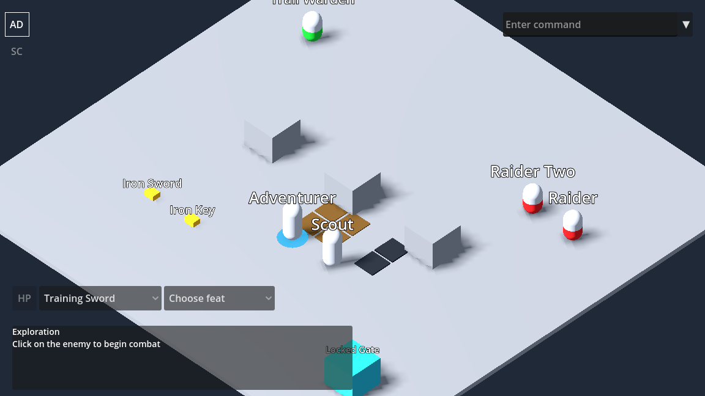

# retro rpg remaker

2026-11-14-11-06-50

Open source engine to remake old rpg-like games with the new look

What is it:

If you want to play old rpg-like games from around 1988 onwards with the new look, like 'modern' rpg classics, you've come to the right place.

Goal:

Create modular rpg engine, first with well known rpg-like rules, then add other options, like first person view, blobbers (like strength and spells), cyber rpg, nuclear wasteland, old space rpg for those traveling in space :), saints with swords, etc ...

Make it ai developer friendly. Think everything configurable using (json) config files, even for 'finished', shipped game. Maybe gui editor later.

Status:

Not much to look at right now. Mostly adding basic stuff.

Using codex plus subscription. Mostly terra 5.6 (6.1 is weirdly lazy), works better than 6.1 even with 256k window context

Godot engine, off course.

License BSD 2 - simple, like all the stuff I publish.

progress report:

<!-- Universal RPG Engine - progress.md
last modified (local): 2026-11-14-11-06-50
instructions: on modify, update string.
-->

# Project progress

Project started (local): 2026-11-02-06-33-00

## Assessment (local): 2026-11-14-11-06-50

- First playable vertical slice: ~55% complete.
- Full reusable Universal RPG Engine scope: ~30% complete.

| Department | Estimate | Status |
|---|---:|---|
| Foundation / data loading | 90% | Godot structure, JSON data, characters, races, classes, and skills are present. |
| Exploration / maps | 75% | Three connected areas, selection, navigation, and interactions are present. |
| Combat framework | 60% | Turns, grid movement, attacks, reactions, and several actions are present. |
| Character rules | 35% | Core attributes and skills exist; saves, conditions, armor, spells, and progression remain. |
| Quest, save/load, UI | 75% | One working quest, reward, persistence, HUD, and MCP support are present. |
| Content / art | 20% | Functional placeholders exist; coherent low-poly art and more content remain. |
| Modding foundation | 15% | Data-driven pieces exist; schemas, override system, and example ruleset remain. |
| Future engine modes | 0–5% | Blobber, procedural variation, extra rulesets, and RTwP are not started. |

The immediate bottlenecks are the rules layer, content and art pass, and modding architecture.

